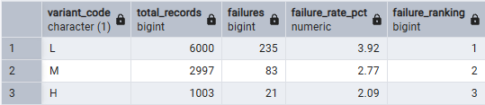
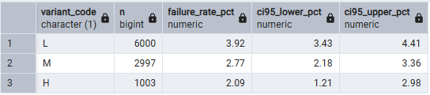
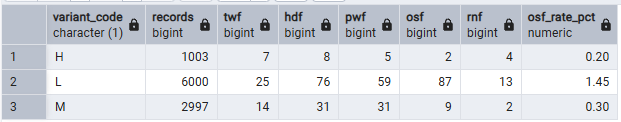
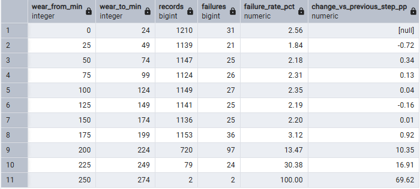
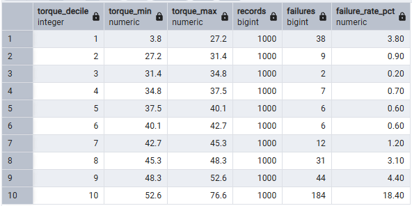
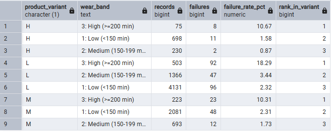
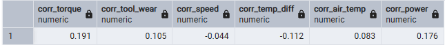
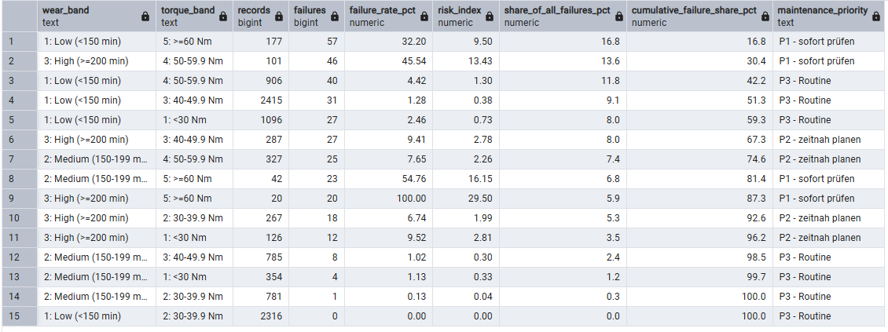

# Predictive Maintenance mit SQL: Welche Maschinen fallen aus und warum?

SQL-Analyse von Maschinenausfällen auf Basis des UCI-Datensatzes **AI4I 2020 Predictive Maintenance**
(10.000 Produktionsdatensätze). Das Projekt beantwortet fünf Fragen eines produzierenden Unternehmens und
leitet aus jeder Auswertung eine konkrete Handlungsempfehlung ab.

> **Wichtig:** Das Projekt untersucht Zusammenhänge und Risikogruppen. Es wird **kein Machine-Learning-Modell**
> entwickelt und keine Ausfallprognose erstellt. Zusammenhänge sind keine bewiesenen Ursachen.

---

## 1. Business-Szenario

Ein Unternehmen möchte ungeplante Maschinenausfälle reduzieren und erfasst dafür Betriebsparameter wie
Temperatur, Drehzahl, Drehmoment und Werkzeugverschleiß. Als Data Analyst beantworte ich mit SQL:

1. Welche Produktvarianten und Betriebszustände sind besonders ausfallgefährdet?
2. Welche Faktoren hängen mit Ausfällen zusammen?
3. Welche Fehlerarten treten am häufigsten auf?
4. Wie lässt sich die Wartung priorisieren?

## 2. Die wichtigsten Ergebnisse auf einen Blick

| Frage | Kennzahl | Quelle (View) | Ausgangswert | Was die Kennzahl zeigt |
| ----- | -------- | ------------- | ------------ | ---------------------- |
| **1. Welche Varianten und Betriebszustände sind ausfallgefährdet?** L |
| **2. Welche Faktoren hängen mit Ausfällen zusammen?** | Ausfallrate je Risikofaktor (Verschleiß, Drehmoment, Drehzahl, Temperaturdifferenz, Leistung) | `vw_operational_risk` | Verschleiß ab 200 Min: 15,4 %, Drehmoment ab 60 Nm: 41,8 %, Drehzahl unter 1.300 rpm: 23,2 %, Temperaturdifferenz unter 8,6 K: 17,5 % |
| **3. Welche Fehlerarten treten am häufigsten auf?** | Verteilung der Fehlerarten, gesamt und je Variante | `vw_failure_modes`, `vw_failure_modes_by_variant` | Am häufigsten: Wärmeabfuhr (HDF), Überlast (OSF), Leistung (PWF); bei L 87 der 98 OSF-Fälle | Worauf Wartungsteams geschult werden und wo die Maßnahmen ansetzen |
| **4. Wie lässt sich die Wartung priorisieren?** | Anteil der Ausfälle in P1-Segmenten | `vw_maintenance_priority` | 4 P1-Segmente = 43 % aller Ausfälle auf 3,4 % der Produktion | Ob die Wartung auf die richtigen Segmente konzentriert ist und die Priorisierung greift |
| **5. Welche Kennzahlen sollte das Management überwachen?** | Gesamt-Ausfallrate | `vw_failure_overview` | 3,39 % (339 von 10.000) | Baseline, an der sich der Erfolg aller Maßnahmen messen lässt |
| | Anzahl Datenqualitäts-Warnungen | `vw_data_quality_checks` | 9 Ausfälle ohne Fehlerart, 18 RNF ohne Ausfall, 24 Mehrfach-Fehlerarten | Wie verlässlich alle anderen Kennzahlen sind |

---

## 3. Projektarchitektur

Das Projekt ist in vier Schichten aufgebaut, wie in echten Datenprojekten üblich. Jede Schicht hat eine eigene
SQL-Datei und baut auf der vorherigen auf.

```
ai4i2020.csv
    │
    ▼
01 Source      raw_ai4i_data            Rohdaten unverändert laden
    │
    ▼
02 Staging     stg_machine_data         Datentypen, Bereinigung, Qualitätschecks
    │
    ▼
03 Analytics   fact_production          Datenmodell (Sternschema) und
               dim_product_variant      Einteilung der Betriebszustände
               dim_failure_mode
               fact_failure_mode
    │
    ▼
04 Reporting   vw_failure_overview      Business-Views für Dashboards
               vw_failure_by_variant
               vw_failure_modes
               vw_failure_modes_by_variant
               vw_operational_risk
               vw_maintenance_priority
```

| Datei | Inhalt |
|---|---|
| `01_source_raw.sql` | Rohdaten-Tabelle (alle Spalten als Text, Originalnamen) und CSV-Import |
| `02_staging.sql` | Typumwandlung, abgeleitete Spalten, Data-Quality-Checks (`vw_data_quality_checks`) |
| `03_analytics.sql` | Faktentabelle, Dimensionen, Zuordnungstabelle für Fehlerarten, Bänder für Betriebszustände |
| `04_reporting_views.sql` | Sechs Business-Views für Management und BI-Tools |
| `05_advanced_analysis.sql` | Die Analysen A1 bis H (CTEs, Window Functions, LAG, NTILE, Subqueries, CORR) |

### Ausführung

1. PostgreSQL-Datenbank anlegen.
2. `01_source_raw.sql` ausführen und die CSV importieren (`\copy`-Zeile im Skript anpassen oder den Import-Dialog von pgAdmin/DBeaver nutzen).
3. `02` bis `04` der Reihe nach ausführen.
4. Die Abfragen aus `05_advanced_analysis.sql` einzeln ausführen.

### Wichtige Modellierungsentscheidungen

- **Rohdaten bleiben unverändert**, damit jedes Ergebnis bis zur Quelle nachvollziehbar ist.
- **Keine Datensätze werden gelöscht.** Auffällige Zeilen werden über die Spalte `dq_flag` markiert.
- **Mehrere Fehlerarten pro Datensatz sind möglich.** Deshalb bleiben TWF, HDF, PWF, OSF und RNF als einzelne Spalten erhalten und werden zusätzlich in `fact_failure_mode` abgebildet.
- **Ausfallraten statt absoluter Zahlen:** Die Varianten sind unterschiedlich groß (L 6.000, M 2.997, H 1.003), deshalb wird immer in Prozent verglichen.

---

## 4. Datenqualität

Alle Prüfungen laufen über die View `vw_data_quality_checks`.

| Prüfung | Ergebnis |
|---|---|
| Anzahl Datensätze (Roh = Staging) | 10.000, vollständig übernommen |
| Doppelte IDs (`UDI`, `Product ID`) | keine |
| Fehlende Werte | keine |
| Ungültige Wertebereiche (Temperatur, Drehzahl, Drehmoment, Verschleiß) | keine |

Auffälligkeiten, die dokumentiert, aber nicht gelöscht wurden:

- **9 Datensätze** mit Ausfall, aber ohne gesetzte Fehlerart.
- **18 Datensätze** mit der Fehlerart „Random Failure“ (RNF), aber ohne Ausfall. Deshalb zählt RNF nur 1 von 19 Fällen als Ausfall.
- **24 Datensätze** mit mehr als einer Fehlerart gleichzeitig.

---

## 5. Auswertung: Was man sieht und was daraus folgt

Zu jeder Abfrage gibt es drei Teile: **Was man sieht**, **Was das bedeutet** und **Empfohlene Aktion**.

Begriffe, die in den Ergebnissen vorkommen:

- **Ausfallrate:** Anteil der Datensätze mit Maschinenausfall, in Prozent.
- **Werkzeugverschleiß:** Betriebsminuten des Werkzeugs seit dem letzten Wechsel.
- **Drehmoment:** Kraft, mit der die Maschine dreht, in Newtonmeter (Nm).
- **Risikoindex:** Ausfallrate des Segments geteilt durch die Gesamt-Ausfallrate. Ein Wert von 2 bedeutet doppelt so hohes Risiko wie im Durchschnitt.

---

### A1: Welche Produktvariante fällt am häufigsten aus?



**Was man sieht:** Variante L fällt in 3,92 % der Fälle aus, M in 2,77 % und H in 2,09 %.

**Was das bedeutet:** L ist die anfälligste Variante. Sie macht 60 % der Produktion aus und verursacht 69 % aller Ausfälle. Dass L mehr absolute Ausfälle hat, liegt also nicht nur an der größeren Menge, sondern auch an der höheren Rate.

**Empfohlene Aktion:** Bei Variante L zuerst nach den Ursachen suchen, weil hier der größte Hebel liegt.

---

### A2: Ist der Unterschied zwischen den Varianten Zufall?



**Was man sieht:** Zu jeder Ausfallrate gehört ein Bereich, in dem der wahre Wert mit 95 % Wahrscheinlichkeit liegt (Konfidenzintervall): L 3,43–4,41 %, M 2,18–3,36 %, H 1,21–2,98 %.

**Was das bedeutet:** Die Bereiche von L und H überschneiden sich nicht, der Unterschied ist also belastbar. L und M liegen knapp auseinander. M und H überschneiden sich, deshalb lässt sich zwischen beiden kein sicherer Unterschied behaupten. Bei H gibt es nur 1.003 Datensätze, daher ist der Bereich breiter.

**Empfohlene Aktion:** Nur L als eindeutig auffällig behandeln. Zwischen M und H keine Maßnahmen ableiten, solange nicht mehr Daten vorliegen.

---

### B: Welche Fehlerarten treten bei welcher Variante auf?



**Was man sieht:** Die Anzahl der Fehlerarten je Variante. TWF = Werkzeugverschleiß, HDF = Wärmeabfuhr, PWF = Leistung, OSF = Überlastung, RNF = zufällig. Bei L treten 87 der 98 Überlastungsfälle (OSF) auf, das sind 1,45 % der L-Produktion. Bei M sind es 0,30 % und bei H 0,20 %.

**Was das bedeutet:** Ein großer Teil des Unterschieds zwischen den Varianten kommt von Überlastung. Variante L wird offenbar häufiger über ihre Belastungsgrenze gefahren oder verträgt weniger Last.

**Empfohlene Aktion:** Bei Variante L Lastgrenzen und Prozessparameter prüfen und gegebenenfalls Grenzwerte für Drehmoment und Verschleiß in Kombination festlegen.

---

### C: Ab wann steigt das Risiko durch Werkzeugverschleiß?



**Was man sieht:** Die Ausfallrate je 25 Minuten Werkzeugverschleiß. Bis 199 Minuten liegt sie bei etwa 2–3 %. Bei 200 bis 224 Minuten springt sie auf 13,5 %, bei 225 bis 249 Minuten auf 30,4 %. Die letzte Stufe (250 bis 274 Minuten) hat nur 2 Datensätze und sagt nichts aus. Die Spalte `change_vs_previous_step_pp` zeigt die Veränderung zur vorherigen Stufe in Prozentpunkten.

**Was das bedeutet:** Das Risiko steigt nicht langsam, sondern springt an einer Schwelle bei etwa 200 Minuten. Davor ist das Werkzeug unauffällig.

**Empfohlene Aktion:** Eine feste Wechselregel einführen: Werkzeuge spätestens vor Erreichen von 200 Minuten austauschen. Das betrifft laut Daten 801 Datensätze (8 %), die zusammen 123 Ausfälle verursachen.

---

### D: Wie wirkt sich das Drehmoment aus?



**Was man sieht:** Die Datensätze wurden nach Drehmoment sortiert und in zehn gleich große Gruppen zu je 1.000 Datensätzen geteilt (Dezile). Im obersten Dezil (52,6 bis 76,6 Nm) fallen 18,4 % aus, im untersten (3,8 bis 27,2 Nm) 3,8 %. In den mittleren Gruppen liegt die Rate meist unter 1 %.

**Was das bedeutet:** Es gibt einen sicheren mittleren Drehmomentbereich. Sowohl sehr hohes als auch sehr niedriges Drehmoment gehen mit mehr Ausfällen einher, wobei das Risiko oben deutlich größer ist.

**Empfohlene Aktion:** Maschinen im mittleren Drehmomentbereich betreiben und Werte ab etwa 50 Nm überwachen. Den Bereich unter 27 Nm genauer untersuchen, weil dort möglicherweise eine andere Fehlerursache wirkt.

---

### E: Wirkt hoher Verschleiß bei allen Varianten gleich?



**Was man sieht:** Die Ausfallrate je Variante und Verschleißband, mit einem Ranking innerhalb jeder Variante. Bei allen drei Varianten steht „hoher Verschleiß (ab 200 Minuten)“ auf Rang 1: L 18,29 %, H 10,67 %, M 10,31 %.

**Was das bedeutet:** Der Verschleißeffekt gilt für jede Variante. Bei L ist er am stärksten. Bei H beruht der Wert nur auf 75 Datensätzen mit 8 Ausfällen und ist deshalb nur eine grobe Größenordnung.

**Empfohlene Aktion:** Die Wechselregel von 200 Minuten für alle Varianten einführen und bei L besonders konsequent umsetzen.

---

### F: Welche Kombinationen sind besonders gefährlich?


**Was man sieht:** Kombinationen aus Variante, Verschleiß und Drehmoment mit mindestens 30 Datensätzen, deren Ausfallrate mehr als dreimal so hoch ist wie im Durchschnitt. Am höchsten ist Variante L bei hohem Verschleiß und 50 bis 59,9 Nm mit 62,7 % (42 von 67). Bei Variante L mit niedrigem Verschleiß, aber mindestens 60 Nm sind es 35,2 %.

**Was das bedeutet:** Verschleiß allein ist nicht das ganze Bild. Auch ein frisches Werkzeug fällt bei sehr hohem Drehmoment häufig aus. Die Kombination mehrerer Risikofaktoren verstärkt das Problem deutlich.

**Empfohlene Aktion:** Hochrisiko-Kombinationen als Warnzustände definieren, zum Beispiel „Verschleiß ab 200 Minuten und Drehmoment ab 50 Nm“, und im Betrieb vermeiden.

---

### G: Hängen die Messwerte linear mit Ausfällen zusammen?



**Was man sieht:** Korrelationswerte zwischen −1 und +1. Je weiter von 0 entfernt, desto stärker der lineare Zusammenhang mit dem Ausfall. Der höchste Wert ist das Drehmoment mit 0,19, danach die Leistung (0,18) und die Temperaturdifferenz (−0,11).

**Was das bedeutet:** Die Werte sind klein. Das heißt nicht, dass die Faktoren unwichtig sind, sondern dass sie nicht gleichmäßig wirken. Die Auswertungen C und D zeigen, dass das Risiko an Schwellen und in Extrembereichen steigt. Eine einzelne Korrelationszahl erfasst das nicht.

**Empfohlene Aktion:** Das Monitoring nicht auf Durchschnittswerte stützen, sondern auf Grenzbereiche und Schwellenwerte, wie in `vw_operational_risk` ausgewertet.

---

### H: Wo sollte die Wartung zuerst ansetzen?



**Was man sieht:** Alle Kombinationen aus Verschleiß und Drehmoment mit Ausfallrate, Risikoindex und dem Anteil an allen Ausfällen. Die Spalte `cumulative_failure_share_pct` addiert die Anteile von oben nach unten (Pareto-Prinzip). Die Segmente sind in drei Prioritäten eingeteilt:

| Priorität | Bedeutung | Segmente | Beispiel |
|---|---|---|---|
| **P1** | Sofort prüfen | 4 | Hoher Verschleiß und 50–59,9 Nm: 45,5 % Ausfallrate |
| **P2** | Zeitnah planen | 4 | Hoher Verschleiß und 40–49,9 Nm: 9,4 % |
| **P3** | Routine | 7 | Mittlerer Verschleiß und 30–39,9 Nm: 0,1 % |

**Was das bedeutet:** Die vier P1-Segmente enthalten nur 3,4 % der Produktion, aber 43 % aller Ausfälle. Ein kleiner Teil der Betriebszustände verursacht also einen großen Teil des Problems.

**Empfohlene Aktion:** Wartung und Überwachung zuerst auf die P1-Segmente konzentrieren. Das bringt den größten Effekt bei geringstem Aufwand. P2 folgt in der Wartungsplanung, P3 läuft in der Routine mit.

---

### Weitere Betriebsbereiche (View `vw_operational_risk`)

Die View vergleicht die Ausfallrate je Betriebsbereich mit dem Durchschnitt (Risikoindex) und markiert Bereiche mit weniger als 30 Datensätzen als „Low sample“.

| Messgröße | Kritischer Bereich | Ausfallrate | Datensätze |
|---|---|---|---|
| Drehmoment | ab 60 Nm | 41,8 % | 239 |
| Drehzahl | unter 1.300 rpm | 23,2 % | 211 |
| Temperaturdifferenz (Prozess minus Luft) | unter 8,6 K | 17,5 % | 720 |
| Werkzeugverschleiß | ab 200 Minuten | 15,4 % | 801 |
| Leistung | unter 3.500 W oder über 9.000 W | 100 % | 95 |

**Empfohlene Aktion:** Diese Bereiche als Alarmgrenzen in die Maschinenüberwachung übernehmen.

---

## 6. Kennzahlen für das Management

Diese Kennzahlen sollte das Management regelmäßig überwachen. Alle lassen sich direkt aus den Reporting-Views berechnen und in Power BI anbinden.

| Kennzahl | Quelle | Warum wichtig |
|---|---|---|
| Gesamt-Ausfallrate | `vw_failure_overview` | Zeigt, ob Maßnahmen wirken |
| Ausfallrate je Variante | `vw_failure_by_variant` | Zeigt, wo Handlungsbedarf liegt |
| Anteil der Produktion in Hochrisiko-Bereichen | `vw_operational_risk` | Frühindikator, bevor Ausfälle entstehen |
| Verteilung der Fehlerarten | `vw_failure_modes` | Steuert, wofür Wartungsteams geschult werden |
| Anteil der Ausfälle in P1-Segmenten | `vw_maintenance_priority` | Zeigt, ob die Priorisierung greift |
| Anzahl Datenqualitäts-Warnungen | `vw_data_quality_checks` | Sichert die Verlässlichkeit aller Zahlen |

---

## 7. Einschränkungen

- **Synthetischer Datensatz:** Die Daten sind künstlich erzeugt. Laut UCI-Dokumentation entstehen einige Fehlerarten (Leistung, Wärmeabfuhr, Überlast) über feste Regeln. Die 100 % Ausfallrate außerhalb des Leistungsbereichs ist deshalb ein Merkmal der Datengenerierung und in echten Betriebsdaten nicht zu erwarten.
- **Kein Zeitbezug:** Der Datensatz enthält weder Zeitstempel noch Maschinen-IDs. `UDI` ist nur eine laufende Nummer. Deshalb gibt es keine Lebenszyklus-Analyse und keine Wartungsintervalle über die Zeit.
- **Zusammenhang ist keine Ursache:** Die Auswertungen zeigen, wo Ausfälle gehäuft auftreten, nicht, warum.
- **Gewählte Grenzen:** Die Bänder für Verschleiß, Drehmoment, Drehzahl und Temperaturdifferenz sind explorativ festgelegt. Andere Grenzen können zu leicht anderen Ergebnissen führen.
- **Kleine Stichproben:** Segmente mit wenigen Datensätzen (zum Beispiel H mit hohem Verschleiß, n = 75) sind nur grobe Anhaltspunkte.

## 8. Verwendete Technologien und SQL-Techniken

- **PostgreSQL** und pgAdmin
- Datenmodellierung im Sternschema (Fakten- und Dimensionstabellen)
- CTEs, Subqueries, Views
- Window Functions: `RANK()`, `LAG()`, `NTILE()`, `SUM() OVER`, `PARTITION BY`
- `CASE WHEN` für Risikokategorien, `UNION ALL` für die Fehlerarten, Conditional Aggregation
- Statistik in SQL: Konfidenzintervalle und `CORR()`

## 9. Datenquelle

UCI Machine Learning Repository: *AI4I 2020 Predictive Maintenance Dataset*
<https://archive.ics.uci.edu/dataset/601/ai4i+2020+predictive+maintenance+dataset>
